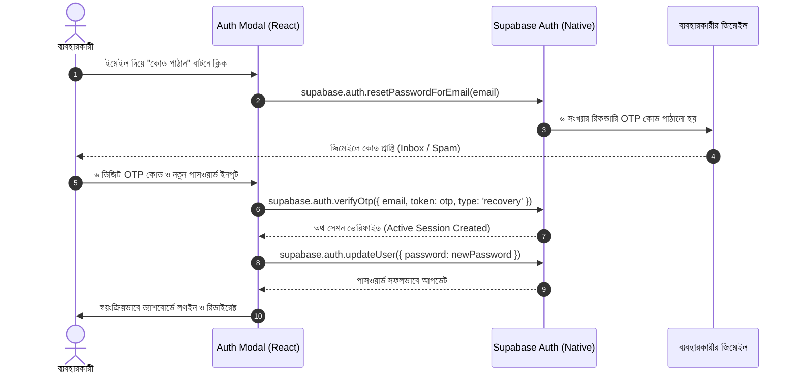

# Supabase Native OTP Password Reset & Auto-Login Implementation Plan

ব্যবহারকারীর চাওয়া অনুযায়ী Supabase Auth-এর নিজস্ব ইমেইল রিকভারি সার্ভিস ব্যবহার করে জিমেইলে ৬-ডিজিট ওটিপি (OTP) পাঠানো হবে। কোড যাচাই করে সাথে সাথে নতুন পাসওয়ার্ড সেট করা হবে এবং ব্যবহারকারী স্বয়ংক্রিয়ভাবে সরাসরি অ্যাপে লগইন হয়ে যাবেন।

---

## ১. আর্কিটেকচার ও কাজের ধাপ (Workflow)

---

## ২. প্রস্তাবিত পরিবর্তনসমূহ

### ক. `src/pages/Auth.tsx` (পাসওয়ার্ড রিসেট মডাল রিডিজাইন)
- **Step 1: ওটিপি পাঠানো (Request OTP)**
  - ব্যবহারকারী শুধু তার ইমেইল প্রদান করবেন।
  - `supabase.auth.resetPasswordForEmail(email.trim())` কল হবে।
  - সফল হলে মডালটি Step 2-এ চলে যাবে এবং ব্যবহারকারীকে স্পষ্টভাবে বার্তা দেখানো হবে: *"আপনার জিমেইলে ৬ ডিজিটের একটি ভেরিফিকেশন কোড পাঠানো হয়েছে।"*
  - পুনরায় কোড পাঠানোর জন্য ৬০ সেকেন্ডের কাউন্টডাউন টাইমার থাকবে।

- **Step 2: ওটিপি ও নতুন পাসওয়ার্ড ভেরিফিকেশন (Verify OTP & Set New Password)**
  - ব্যবহারকারী ৬ ডিজিটের কোড এবং নতুন পাসওয়ার্ড ইনপুট করবেন।
  - `supabase.auth.verifyOtp({ email: email.trim(), token: otp.trim(), type: 'recovery' })` দিয়ে ওটিপি ভেরিফাই হবে।
  - সফল হলে সাথে সাথে `supabase.auth.updateUser({ password: newPassword.trim() })` দিয়ে পাসওয়ার্ড পরিবর্তন করা হবে।
  - যেহেতু `verifyOtp` একটি সেশন তৈরি করে দেয়, তাই ব্যবহারকারীকে আবার লগইন পেজে যেতে হবে না; অ্যাপ তৎক্ষণাৎ তার প্রোফাইল ফেচ করে ড্যাশবোর্ডে রিডাইরেক্ট করবে।

### খ. এরর ও স্প্যাম ফোল্ডার হ্যান্ডলিং
- জিমেইল সার্ভিসের নিরাপত্তা ফিল্টারের কারণে মাঝে মাঝে ইমেইল Spam বা Updates ফোল্ডারে যেতে পারে, ব্যবহারকারীকে ইনবক্সের পাশাপাশি স্প্যাম ফোল্ডার চেক করার নির্দেশিকা দেখানো হবে।
- রেট লিমিট বা ভুল ওটিপি দিলে বাংলায় স্পষ্ট এরর মেসেজ প্রদর্শিত হবে।

---

## ৩. ভেরিফিকেশন ও টেস্ট প্ল্যান
1. **ওটিপি রিকোয়েস্ট টেস্ট:** জিমেইল দিয়ে রিসেট রিকোয়েস্ট পাঠানো এবং ৬ সংখ্যার কোড পাওয়ার সত্যতা নিশ্চিত করা।
2. **ওটিপি ভ্যালিডেশন টেস্ট:** ভুল ওটিপি দিলে উপযুক্ত এরর মেসেজ আসা এবং সঠিক ওটিপি দিলে সেশন তৈরি হওয়া পরীক্ষা করা।
3. **পাসওয়ার্ড আপডেট ও অটো-লগইন টেস্ট:** ওটিপি ভেরিফাই হওয়ার পর নতুন পাসওয়ার্ড সেট হওয়া এবং কোনো অতিরিক্ত স্টেপ ছাড়াই ব্যবহারকারীর সরাসরি প্যানেল ওপেন হওয়া যাচাই করা।
4. **বিল্ড ও লিন্ট ভেরিফিকেশন:** `tsc --noEmit` এবং `npm run build` চালিয়ে কোড কম্পাইলেশন নিশ্চিত করা।
